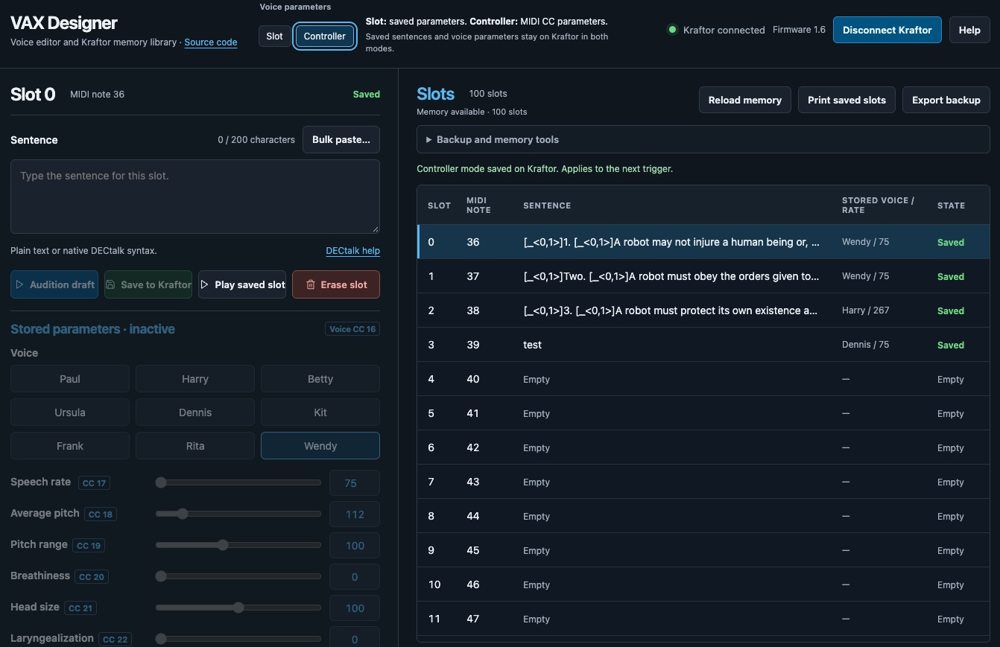

# VAX Designer

A browser editor for Kraftor VAX sentences and voice settings. Save phrases to
Kraftor's FRAM memory, then trigger them by MIDI with Kraftor running standalone.

## Start here

1. Connect Kraftor with a USB data cable and open `index.html` in a browser that supports USB MIDI device access.
2. Click **Connect Kraftor** and allow access. The connected firmware version appears beside the connection status.
3. Select a slot on the right. Choose **Slot** under **Voice parameters** to edit its voice settings.
4. Enter a sentence, choose a voice and adjust the sliders. **Audition draft** lets you hear it before saving.
5. Click **Save to Kraftor**. **Play saved slot** plays the saved sentence using the selected parameter mode.

Audition works without FRAM; saving requires initialized FRAM. **Format** erases
existing memory and asks for confirmation. Once saved, phrases survive a restart.

## Slot or Controller mode

This is one global choice for all slots, saved on Kraftor and restored at startup.

| Mode | Voice parameters used when a phrase plays |
| --- | --- |
| **Slot** | Each sentence's saved voice, rate and design. Use this to prepare a different voice for each slot. |
| **Controller** | The live profile set by MIDI CC16–22 or serial `/v`, `/r`, `/d`. The slot supplies the sentence. |

In Controller mode, GUI voice controls are disabled; saving an edited sentence
preserves its stored voice settings. Both **Audition draft** and **Play saved
slot** follow the selected mode. Inline DECtalk commands can override either
profile.

Live controller values affect the next trigger and remain in RAM. Restart or
CC121 clears design overrides and returns to Paul at rate 75 with its natural voice settings. Changing modes does
not erase saved sentences or their settings. Older banks default to Slot;
older firmware may require an update to enable mode selection.

## Slots, drafts and MIDI

- The bank holds **100 slots**. Slots **0–91** map to MIDI notes **36–127** (`note = slot + 36`). Slots **92–99** can be played from Designer or the serial `/pN` command.
- Edits are browser drafts until you click **Save to Kraftor**. **Reset voice settings** restores the draft's design controls and rate 75 while keeping the sentence and chosen voice.
- **Bulk paste…** accepts one sentence per line or `@one@two@three`. Review the destinations and click **Load drafts**, then audition and save each slot. It preserves existing slot profiles; empty destinations use the editor settings.
- Sentences use ASCII text, up to **200 characters**. Text and voice design must also fit the slot's byte limit. Invalid bulk pastes are rejected as a whole.

Send notes and CCs on Kraftor's displayed MIDI channel. After changing physical
DIP switches, restart Kraftor and click **Refresh** to read the channel again.
Sliders edit drafts; they do not send live CC messages.

| CC | Parameter | MIDI values → parameter range |
| --- | --- | --- |
| 16 | Voice | 0–127 across nine voices: Paul, Harry, Betty, Ursula, Dennis, Kit, Frank, Rita, Wendy |
| 17 | Speech rate | 0–127 → 75–600 |
| 18 | Average pitch | 0–127 → 50–500 |
| 19 | Pitch range | 0–127 → 0–250 |
| 20 | Breathiness | 0–127 → 0–70 |
| 21 | Head size | 0–127 → 65–135 |
| 22 | Laryngealization | 0–127 → 0–100 |
| 121 | Reset live controller profile | Any value |

## DECtalk sentences

The **Sentence** box accepts ordinary text, native DECtalk commands and phonemes.
For example, `[:dv ap 90 pr 0]Hello.` changes the voice design within a sentence.
Use **DECtalk help** beside the editor for pronunciation, pauses and singing
examples, or read the bundled [DECtalk user guide](assets/EpsonDECtalk501.pdf).
Native commands stay in the saved sentence and count toward its limits.

Serial commands such as `/v`, `/r` and `/d` belong in a terminal, not the Sentence
box. Keep the `assets` folder with `index.html` when sharing the Designer.

## Backups and printing

**Export backup** saves the FRAM bank and mode as JSON. Import loads a backup
locally; **Restore** writes it to Kraftor. **Print saved slots** rereads FRAM and
prints populated saved slots, their stored settings and MIDI mappings. Drafts,
temporary serial phrases and live controller values are excluded.

## Serial terminal

Open **Older firmware / serial tools → Connect serial**, or use a separate
terminal at **115200 baud**. Disconnect serial before using the main connection.
Designer memory operations use the main USB MIDI connection.

The following commands are available in the updated firmware 1.6 build. Earlier
1.6 builds may lack `/g0`, `/g1` and `/pN`; flash the latest local `firmware.uf2`.

| Command | Action |
| --- | --- |
| `/h` | Show full serial help. |
| `/f` | Show firmware version. |
| `/l` | List saved FRAM slots, MIDI notes, stored settings, sentences and current mode. |
| `/m` | Show MIDI channel, CC controls, current mode and temporary mappings. |
| `/g0` | Select and save Slot mode. |
| `/g1` | Select and save Controller mode. |
| `/pN` | Play saved slot 0–99 using the current mode, e.g. `/p0`. |
| `/v4`, `/r200`, `/d ap 90 pr 0` | Set live voice, rate or design parameters. |
| `/o` | Reset live design parameters. |
| `/i` | Show the terminal's voice settings. |
| Text + Enter | Speak the text. |
| `@one@two@three` | Load temporary MIDI phrases into RAM. |

Temporary `@` phrases use notes 36–47, up to 12 phrases. They take priority over
matching saved-slot MIDI triggers, disappear on restart and never write FRAM.
Designer **Play saved slot** and serial `/pN` still play the saved FRAM slot.

CC map version 2 uses the full CC16 range in nine bands: 0–14 Paul, 15–28 Harry,
29–42 Betty, 43–56 Ursula, 57–71 Dennis, 72–85 Kit, 86–99 Frank, 100–113 Rita,
114–127 Wendy. Each preset keeps its natural design until CC18–22 overrides a
parameter; overrides persist across voice changes until reset. Older map
version 1 uses direct CC16 voice numbers 0–8; the connected badge and printed
reference follow the reported map. Stored slot voices and serial `/v0`–`/v8`
still use direct voice numbers. Embedded sentence commands retain priority.
